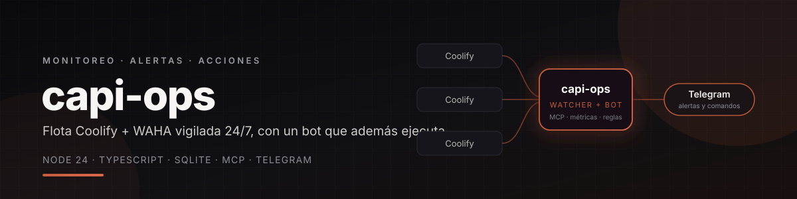
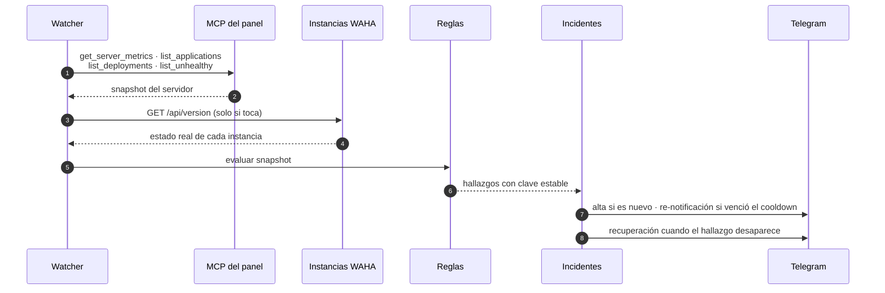
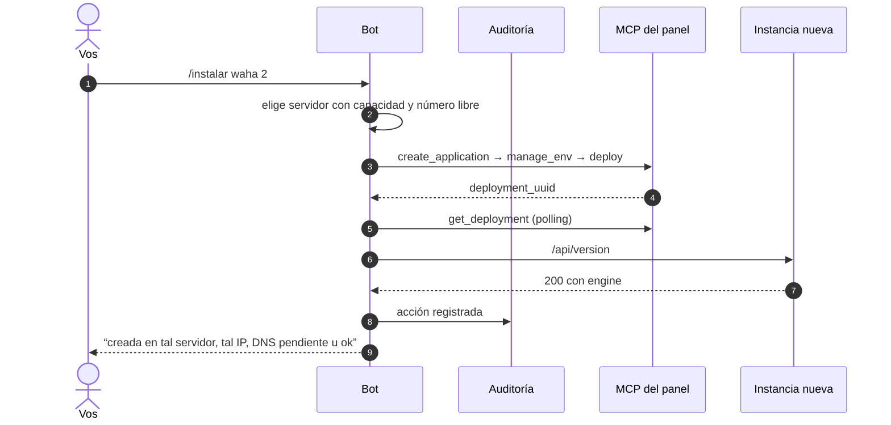

<div align="center">



<br/>

**Un vigía que nunca duerme para tus paneles de Coolify: mide, avisa y además ejecuta lo que le pedís desde el celular.**

Node 24 · TypeScript · SQLite · MCP · bot de Telegram · sin base de datos externa

**por [nocodeveloper · Joel Araujo](https://github.com/iamnocodeveloper)**

<br/>

[](https://github.com/iamnocodeveloper/capi-ops/actions/workflows/ci.yml)
[](./LICENSE)
[](https://nodejs.org)
[](https://www.typescriptlang.org)
[](https://core.telegram.org/bots/api)
[](https://coolify.io)
[](./Dockerfile)

<br/>

[**Respuestas rápidas**](#-respuestas-rápidas) · [**Qué vigila**](#-qué-vigila) · [**Comandos**](#-comandos-del-bot) · [**Arquitectura**](#-arquitectura) · [**Arranque rápido**](#-arranque-rápido) · [**Despliegue**](#-despliegue) · [**Documentación**](#-documentación)

</div>

---

## ⚡ Respuestas rápidas

| Pregunta | Respuesta |
|---|---|
| **¿Reemplaza a Coolify?** | No. Coolify sigue siendo el panel y el dueño del ciclo de vida. capi-ops lo mira desde afuera por su servidor MCP y avisa lo que Coolify no avisa. |
| **¿Cómo habla con los paneles?** | MCP sobre Streamable HTTP (`initialize` + `tools/call`) con un token de equipo por panel. Mismo protocolo que usaría cualquier agente. |
| **¿Por qué no un agente con LLM?** | Porque apagar un contenedor no debería ser creativo. Las reglas son explícitas y auditables; hay un `POST /intent` para enchufar un LLM como front si algún día hace falta. |
| **¿Dónde corre?** | En un contenedor propio, idealmente en un host distinto al que monitorea: si el watcher vive en el servidor vigilado, cuando ese servidor cae también cae el que avisa. |
| **¿Necesita base de datos?** | No. SQLite embebido (`node:sqlite`) guarda incidentes, muestras, inventario y auditoría en un solo archivo. Si se pierde, se regenera. |
| **¿Se puede usar sin Telegram?** | Sí. Sin `TG_TOKEN` corre en modo consola y las alertas se imprimen en el log. |
| **¿Es seguro dejar que ejecute?** | Allowlist por chat y usuario, botón de confirmación, `delete` pide tipear parte del UUID, modo solo-lectura y auditoría de cada acción. |
| **¿Guarda secretos en el repo?** | No. La flota se pasa por `SERVERS_JSON` o un archivo ignorado por git; los tokens se referencian por variable de entorno. |

---

## 🔭 Qué vigila

| | |
|---|---|
| **Recursos** | CPU, memoria, disco y load por servidor, con umbral configurable y detección de anomalías contra la línea base de la misma franja horaria. |
| **Contenedores** | Aplicaciones que dejaron de estar `running`, bucles de reinicio y cola de despliegues trabada. |
| **Instancias** | Health real de cada instancia WAHA por HTTPS (`/api/version`): distingue entre contenedor caído, aplicación sin responder y dominio mal apuntado. |
| **DNS** | Si el dominio de una instancia no resuelve a la IP del servidor, lo dice con nombre y apellido. |
| **Ciclo de vida** | Cada incidente se abre una vez, se re-notifica con cooldown, se cierra con un mensaje de recuperación y se resume en un digest diario. |

**Anti-ruido por diseño:** deduplicación por clave estable, cooldown de re-notificación, agrupación
por servidor cuando falla más de una instancia y horario silencioso que solo deja pasar las críticas.

---

## 💬 Comandos del bot

| Comando | Qué hace |
|---|---|
| `/estado` | Resumen de los servidores y los incidentes abiertos |
| `/instancias [srv]` | Inventario: instancia, contenedor, salud web y dominio. Sin argumento recorre todo |
| `/servidores` | IP, cantidad de aplicaciones y rango de instancias |
| `/salud [srv]` | CPU, memoria, disco, load y despliegues en curso |
| `/waha <instancia\|uuid>` | Estado de una instancia, sesiones de WhatsApp y DNS |
| `/buscar <texto>` | Busca aplicaciones y dominios en toda la flota |
| `/logs <instancia> [n]` | Últimas líneas de un contenedor |
| `/incidentes` · `/auditoria` | Incidentes abiertos · últimas acciones ejecutadas |
| `/instalar waha [n] [srv]` | Crea instancias, elige el servidor con capacidad y reporta dónde quedaron |
| `/deploy` · `/restart` · `/stop` · `/delete` | Acciones con botón de confirmación; `delete` pide tipear `CONFIRMAR <instancia>` |
| `/modo solo-lectura` \| `/modo normal` | Congela o habilita las acciones |

Los argumentos aceptan el alias del servidor o su número. Todo comando queda registrado con usuario,
resultado y duración.

---

## 🏗 Arquitectura

```mermaid
flowchart TB
    subgraph Host["Host de monitoreo · contenedor propio"]
        W["watcher<br/><i>ciclo cada 60 s</i>"]
        R["reglas<br/><i>umbrales + z-score</i>"]
        I["incidentes<br/><i>abrir · cooldown · cerrar</i>"]
        B["bot<br/><i>comandos + confirmaciones</i>"]
        E["executor<br/><i>instalar · deploy · restart</i>"]
        DB[("SQLite<br/>incidentes · métricas<br/>inventario · auditoría")]
    end

    subgraph Paneles["Paneles Coolify"]
        M1["MCP<br/><i>métricas, apps, deploys</i>"]
        M2["MCP"]
    end

    WAHA["Instancias WAHA<br/>/api/version"]
    TG["☁️ Telegram<br/><i>alertas + comandos</i>"]

    W --> R --> I
    W --> DB
    I --> TG
    B --> TG
    B --> E
    E --> DB
    W -->|JSON-RPC| M1
    W -->|JSON-RPC| M2
    W -->|HTTPS| WAHA
```



### Un ciclo completo



### Cuando le pedís algo



---

## 🧩 Stack

| Capa | Elección | Por qué |
|---|---|---|
| Runtime | **Node 24** | `node:sqlite` y `fetch` vienen incluidos: cero dependencias nativas. |
| Lenguaje | **TypeScript** `strict` | El shape de cada herramienta MCP está modelado a mano y validado en el borde. |
| Protocolo | **MCP (Streamable HTTP)** | Es la vía oficial de Coolify para agentes; no hay que scrapear la UI. |
| Bot | **grammY** | Tipado, inline keyboards y manejo de errores sin boilerplate. |
| Estado | **SQLite** | Un archivo, transaccional, sin servidor que administrar. |
| Config | **zod** | La flota entera se valida al arrancar y falla fuerte si está mal. |
| HTTP | **node:http** | Tres endpoints; un framework sería más peso que ayuda. |
| Despliegue | **Docker** | Imagen multi-stage con `node:24-alpine`. |

---

## 🚀 Arranque rápido

```bash
git clone https://github.com/iamnocodeveloper/capi-ops.git
cd capi-ops

npm install --include=dev
cp .env.example .env
cp config/servers.example.json config/servers.json

npm run dev        # sin TG_TOKEN corre en modo consola
```

### Conectar tus paneles

1. En cada panel de Coolify, generá un **token de API** con las habilidades `read`, `read:sensitive`,
   `write` y `deploy`.
2. Completá `config/servers.json` con la URL del MCP de cada panel, la variable que guarda el token
   (`tokenEnv`), la IP del servidor y los UUID de proyecto, servidor y destino de Docker.
3. Cargá los tokens en `.env` como `CAPI1_TOKEN`, `CAPI2_TOKEN`, …

> **Nota sobre `NODE_ENV`**: si tu shell tiene `NODE_ENV=production`, npm omite las devDependencies y
> `tsc` desaparece. Usá siempre `npm install --include=dev`.

### Conectar Telegram

1. `@BotFather` → `/newbot` → guardá el token.
2. Agregá el bot a tu chat, mandale un mensaje y sacá el `chat_id` con `getUpdates`.
3. Cargá `TG_TOKEN`, `TG_ALLOWED_CHATS` y `TG_ALLOWED_USERS`. Cualquier otro chat se ignora y se
   registra en el log.

---

## 📦 Despliegue

### Docker

```bash
docker build -t capi-ops .
docker run -d --name capi-ops -p 8080:8080 \
  -v capi-ops-data:/data \
  --env-file .env \
  capi-ops
```

### EasyPanel / cualquier PaaS con Dockerfile

1. Servicio **App** con Dockerfile desde el repo.
2. Variables de entorno del `.env` y volumen persistente en `/data`.
3. Puerto del contenedor `8080` (opcional publicarlo para `/health`).
4. Telegram funciona por **polling**: no necesita dominio, certificado ni ingress.

> Si el deploy devuelve OK pero el `uptime` de `/health` no baja, no recreó el contenedor. El
> workaround está documentado en [`docs/operacion.md`](./docs/operacion.md).

### Checklist de producción

- [ ] `SERVERS_JSON` (o el archivo de flota) con todos los paneles y sus tokens cargados.
- [ ] `TG_ALLOWED_CHATS` y `TG_ALLOWED_USERS` con la allowlist real, nunca vacíos en producción.
- [ ] `OPS_READ_ONLY=true` mientras se valida la conexión; después habilitar acciones.
- [ ] Volumen persistente para `/data`.
- [ ] `HEARTBEAT_URL` configurado para detectar si el watcher mismo muere.
- [ ] Métricas de Sentinel habilitadas en cada panel (si no, no hay CPU/memoria que leer).

---

## 🎛 Configuración

| Variable | Para qué | Default |
|---|---|---|
| `TG_TOKEN` | Token de BotFather | — |
| `TG_ALLOWED_CHATS` · `TG_ALLOWED_USERS` | Allowlist dura de chat y usuario | vacío |
| `TG_ADMIN_CHAT` | Chat para auditoría de acciones destructivas | primer chat |
| `CAPIx_TOKEN` | Token MCP de cada panel (referenciado desde la flota) | — |
| `WAHA_API_KEY` | `X-Api-Key` de las instancias | — |
| `SERVERS_JSON` | Flota completa en JSON inline (prioridad sobre el archivo) | vacío |
| `OPS_READ_ONLY` | Bloquea toda acción que no sea de lectura | `false` |
| `POLL_SECONDS` | Ciclo del watcher | `60` |
| `WAHA_PROBE_SECONDS` | Cada cuánto se revisan los dominios | `300` |
| `TH_CPU` · `TH_MEM` · `TH_DISK_WARN` · `TH_DISK_CRIT` | Umbrales (%) | 85 / 90 / 80 / 90 |
| `RENOTIFY_MINUTES` | Cooldown de re-notificación | `360` |
| `QUIET_HOURS` | Silencio, formato `23:00-07:00` | vacío |
| `DIGEST_AT` | Digest diario | `09:00` |
| `HEARTBEAT_URL` | Ping externo (healthchecks.io) | vacío |
| `INTENT_TOKEN` | Secreto para `POST /intent` | vacío |

La flota **no vive en el repo**: se pasa por `SERVERS_JSON` o por un `config/servers.json` ignorado por
git. Se versiona solo [`config/servers.example.json`](./config/servers.example.json) con placeholders.

---

## 🔌 API

| Endpoint | Qué devuelve |
|---|---|
| `GET /health` | Estado del servicio y snapshot de la flota |
| `GET /metrics` | Métricas en formato Prometheus |
| `POST /intent` | Hook para un front LLM. Requiere header `x-ops-token` y solo acepta intents de un enum cerrado |

```bash
curl -s -X POST http://localhost:8080/intent \
  -H "x-ops-token: $INTENT_TOKEN" -H 'content-type: application/json' \
  -d '{"text":"instalá 2 waha"}'
```

---

## 🗂 Estructura

```
src/
  config.ts     env + flota (zod), con SERVERS_JSON o archivo
  mcp.ts        cliente JSON-RPC sobre Streamable HTTP
  probe.ts      recolección por servidor y normalización
  waha.ts       health de instancias (HTTP, DNS, sesiones)
  rules.ts      umbrales y anomalías → hallazgos
  incidents.ts  máquina de estados y política de notificación
  installer.ts  numeración, elección de servidor, deploy y verificación
  ops.ts        deploy / restart / stop / delete / logs
  bot.ts        comandos, allowlist, confirmaciones
  http.ts       /health, /metrics, /intent
  db.ts         SQLite: incidentes, métricas, inventario, auditoría
config/         servers.example.json
docs/           arquitectura, operación y assets
```

---

## 🎨 Detalles de diseño

- **Un ciclo, muchas fuentes.** Primero se recolecta todo (MCP + HTTP), después se evalúa: las reglas
  son funciones puras y no hacen red.
- **Claves estables de incidente** (`srv:<alias>:<regla>`): eso permite deduplicar sin estado en
  memoria y sobrevivir a un reinicio del proceso.
- **DNS solo cuando falla el HTTP.** Resolver decenas de dominios por ciclo satura el resolver y genera
  falsos positivos; el chequeo caro se hace únicamente para clasificar el error.
- **Toda acción destructiva deja rastro**: quién la pidió, desde qué chat, resultado y duración.
- **Modo consola** para correr en local sin bot y ver las alertas como texto.

---

## 📚 Documentación

| Documento | Contenido |
|---|---|
| [`docs/arquitectura.md`](./docs/arquitectura.md) | Decisiones con su motivo, flujo del ciclo, módulos, modelo de datos y puntos de extensión. |
| [`docs/operacion.md`](./docs/operacion.md) | Runbook: deploy, workaround de recreación, rotación de tokens, alta de paneles, troubleshooting. |
| [`CHANGELOG.md`](./CHANGELOG.md) | Historial de versiones. |

---

## 👤 Autor

**nocodeveloper · Joel Araujo**

Lo construí para operar mi propia infraestructura sin abrir diez paneles, y lo dejo abierto por si te
sirve.

[](https://github.com/iamnocodeveloper)
[](https://nocodeveloper.site/trabaja-conmigo)

<!-- 🌐 Sitio web: añade aquí tu URL cuando la tengas -->

---

## ☕ Invítame un café… o una birra 🍺

El proyecto es open source y sin ánimo de lucro. Si te ahorra tiempo cada semana, puedes invitarme a un café — o directamente a una birra, que también se agradece 😄

<div align="center">

[](https://paypal.me/nocodeship2024?locale.x=es_XC&country.x=EC)
[](https://www.binance.com/es/pay)

**Binance Pay** → `joeldavidar@gmail.com`

**PayPal** → [paypal.me/nocodeship2024](https://paypal.me/nocodeship2024?locale.x=es_XC&country.x=EC)

</div>

---

## 📄 Licencia

[MIT](./LICENSE) © 2026 nocodeveloper · Joel Araujo

<div align="center">
<br/>

<br/><br/>
<sub><b>nocodeveloper · Joel Araujo</b></sub>
<br/>
<sub>Node 24 · TypeScript · SQLite · MCP · Telegram</sub>
<br/>
<sub>Si te sirvió, <a href="https://paypal.me/nocodeship2024?locale.x=es_XC&country.x=EC">invítame una birra 🍺</a></sub>
</div>
